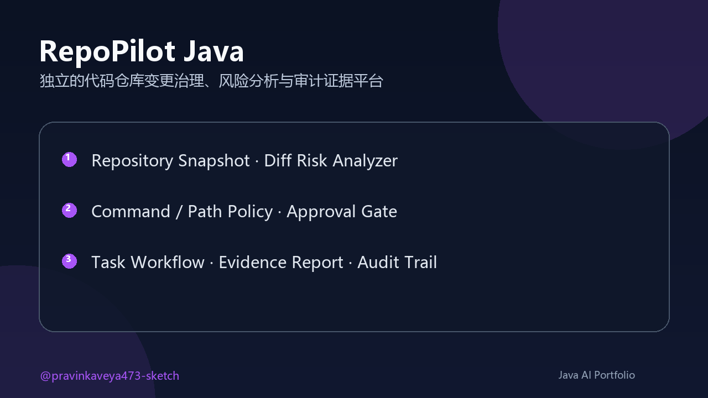
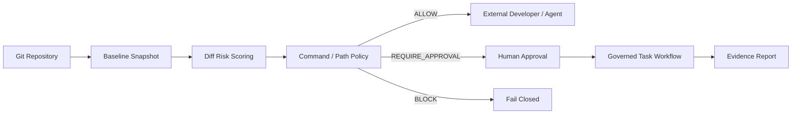

# RepoPilot Java

<p align="center"></p>

<p align="center">
  <a href="https://github.com/pravinkaveya473-sketch/repopilot/actions"></a>
  
  
  
  
  <a href="LICENSE"></a>
</p>

<p align="center"><strong>独立的代码仓库变更治理、风险分析与审计证据 CLI</strong></p>

RepoPilot 在开发者或 Coding Agent 修改仓库之前建立可执行的安全边界：读取仓库基线、评估 Git Diff、判断命令与路径风险、强制任务经过计划/审批/评审状态，并输出可交付的 Markdown 证据报告。

它不调用云端模型、不上传源码、不启用遥测；核心运行时只依赖 Jackson，适合作为任意 AI 编程工具、CI 流程或团队研发规范前面的确定性治理层。

维护者：[@pravinkaveya473-sketch](https://github.com/pravinkaveya473-sketch) · 稳定版：`2.0.0`

[快速开始](#快速开始) · [5 分钟演示](docs/DEMO.md) · [CLI 参考](docs/CLI.md) · [架构设计](docs/ARCHITECTURE.md) · [项目演进](HISTORY.md) · [版本记录](CHANGELOG.md)

## 演示

<p align="center"></p>

## 为什么需要 RepoPilot

AI 能生成代码，但“能改”不等于“应该改”。真实仓库还需要回答：

- 当前基线是什么，工作区是否已经存在未提交修改？
- 本次 Diff 是否涉及认证、迁移、CI、依赖或疑似凭据？
- 一条命令是安全、需要审批，还是无论如何都应阻断？
- 任务是否跳过了计划、审批或代码评审？
- 评审者能否拿到一份包含基线、风险因子和检查清单的证据？

RepoPilot 把这些问题实现为可测试的 Java 规则和稳定的 CLI 退出码，而不是依赖 Prompt 自觉。

## 治理闭环



## 可验证能力

| Capability | Implementation | Verification |
|---|---|---|
| Repository snapshot | Branch, commit, dirty state, files, languages, build systems and engineering signals | `inspect` command + tests |
| Diff risk | 0–100 score for scale, migrations, security, CI/CD, dependencies, config, concurrency and credentials | `risk` command + tests |
| Command policy | Blocks destructive host/Git commands; review-gates mutations, network and publishing | Deterministic exit codes + rule tests |
| Path policy | Repository boundary enforcement and protected secrets/audit files | Normal, review and blocked-path tests |
| Task governance | Mandatory plan → approval → execution → review lifecycle | Transition tests + optimistic versions |
| Durable local state | File lock, temp file and atomic replace | Concurrent-safe store design |
| Audit evidence | Append-only task/tool JSONL with redaction and output hashes | Audit redaction test |
| Review deliverable | Markdown baseline, risks, tasks and reviewer checklist | `report` command + report test |

## 快速开始

### 环境

- JDK 21
- Git 2.x
- Windows、Linux 或 macOS

### 构建

```powershell
.\gradlew.bat clean check shadowJar
java -jar build\libs\repopilot.jar version
```

Linux/macOS：

```bash
./gradlew clean check shadowJar
java -jar build/libs/repopilot.jar version
```

### 30 秒体验

```powershell
java -jar build\libs\repopilot.jar doctor --repo .
java -jar build\libs\repopilot.jar inspect --repo .
java -jar build\libs\repopilot.jar risk --repo .
java -jar build\libs\repopilot.jar policy command --value "git push --force origin main"
java -jar build\libs\repopilot.jar report --repo . --output evidence-report.md
```

## CLI 示例

### 仓库基线

```text
RepoPilot repository snapshot
Branch/commit: main @ 3b88c9a
Working tree: CLEAN
Files: 52 total, 23 source, 13 tests
Languages: {Java=30, Kotlin=2, YAML=3}
Build systems: [Gradle]
Engineering signals: [CI workflow, README, license, security policy, contribution guide]
```

### 策略决策

```powershell
java -jar build\libs\repopilot.jar policy path --repo . --value ".env"
# decision=BLOCK, risk=CRITICAL

java -jar build\libs\repopilot.jar policy path --repo . --value ".github/workflows/release.yml"
# decision=REQUIRE_APPROVAL, risk=HIGH

java -jar build\libs\repopilot.jar policy path --repo . --value "src/main/java/App.java"
# decision=ALLOW, risk=LOW
```

### 受治理任务

```powershell
java -jar build\libs\repopilot.jar task create --repo . --title "Review authentication migration" --risk HIGH --actor developer
java -jar build\libs\repopilot.jar task plan --repo . --id <id> --actor developer
java -jar build\libs\repopilot.jar task approve --repo . --id <id> --actor tech-lead
java -jar build\libs\repopilot.jar task start --repo . --id <id> --actor developer
java -jar build\libs\repopilot.jar task review --repo . --id <id> --actor developer
java -jar build\libs\repopilot.jar task complete --repo . --id <id> --actor reviewer
```

```text
DRAFT → PLANNED → APPROVED → IN_PROGRESS → REVIEW_REQUIRED → COMPLETED
   └──────────────→ CANCELLED         └────→ FAILED → PLANNED
```

运行时数据位于 `.repopilot/`，默认被 Git 忽略。

## 风险模型

分数范围 `0–100`：`LOW < 15`、`MEDIUM < 40`、`HIGH < 70`、其余为 `CRITICAL`。规则会识别：

- 大规模文件/代码行变更
- SQL 与数据库迁移
- 认证、授权和安全代码
- GitHub Actions / GitLab CI
- Maven / Gradle 依赖与构建逻辑
- 运行配置、事务和并发语义
- 删除占比与疑似硬编码凭据

高分不会自动拒绝变更；它要求更多证据和人工复核。真正不可逆的主机或 Git 命令由 Command Policy 直接阻断。

## 工程结构

```text
src/main/java/com/cjl/repopilot
├── cli       # 稳定命令与退出码
├── doctor    # 环境诊断
├── inspect   # 仓库画像
├── risk      # Git Diff 风险评分
├── security  # 命令与路径决策
├── task      # 状态机、文件锁和审计
├── audit     # 参数脱敏与结果哈希
└── report    # Markdown 证据报告
```

## 验证与发布

```powershell
.\gradlew.bat clean check shadowJar
powershell -ExecutionPolicy Bypass -File .\scripts\verify.ps1
```

`check` 同时执行单元测试和无副作用的仓库扫描 Smoke Test。GitHub Actions 对 push/PR 运行同一验证；`v*` 标签会发布独立的 `repopilot.jar`。

## 项目边界

RepoPilot 给出确定性的本地风险信号，不替代操作系统沙箱、组织身份认证、代码审查或 CI 权限控制。V2 当前源码、构建和发布包均为独立实现；早期私有原型的工程演进记录见 [HISTORY.md](HISTORY.md)。

## License

[MIT](LICENSE) © [pravinkaveya473-sketch](https://github.com/pravinkaveya473-sketch)
