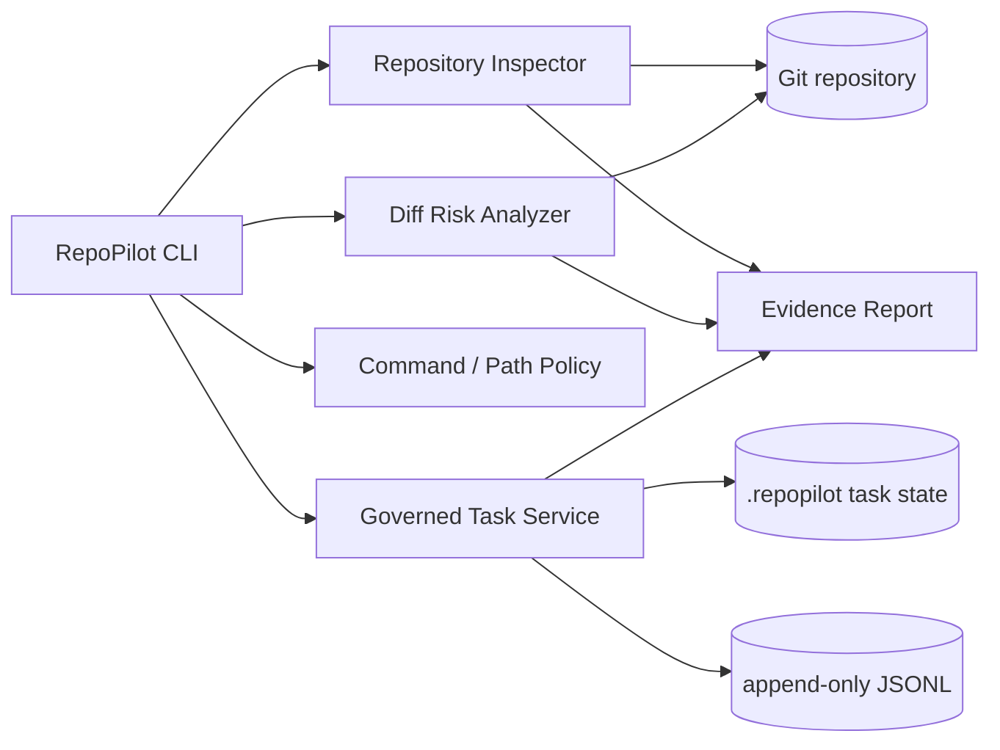

# Architecture

RepoPilot is a local-first Java CLI. Commands are parsed in-process; repository data never leaves the machine.

## Design decisions

### Local-first and provider-neutral

RepoPilot does not contain a model client. It is designed to sit in front of any coding agent, CI job or developer workflow. This keeps repository inspection and safety decisions deterministic and removes API-key handling from the governance layer.

### Fail-closed policy

Command and path assessments return one of `ALLOW`, `REQUIRE_APPROVAL` or `BLOCK`. Destructive host operations, force pushes, hard resets and credential files are blocked. Repository history mutations, dependency changes, CI/CD and database migrations require review.

### Durable task state

Task transitions are validated by the domain enum. Persistence uses an OS file lock, a temporary file and atomic replacement when supported. Every lifecycle mutation appends an audit event.

### Evidence as a deliverable

The report generator combines a repository snapshot, current Git diff risk and governed tasks into portable Markdown. It intentionally includes a human review checklist because a numeric score is not an authorization decision.

## Extension points

- Invoke `policy` before an external agent executes a command or writes a path.
- Store generated evidence as a CI artifact or attach it to a pull request.
- Replace file-backed tasks behind `RepositoryTaskService` with an organization service while preserving transition rules.
- Add organization-specific policy rules with tests before enabling them in automation.
